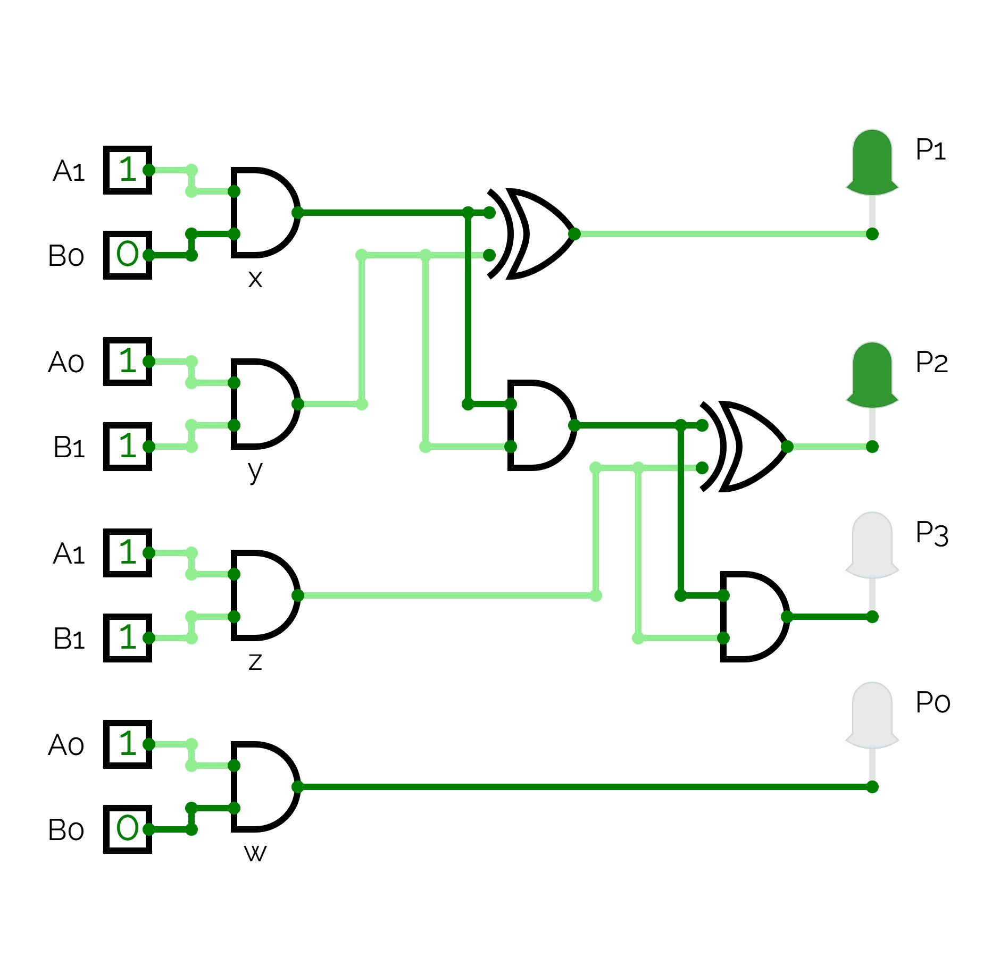

# 2-Bit Binary Multiplier

A CircuitVerse simulation that multiplies two unsigned 2-bit binary numbers, A and B, and displays the 4-bit product.

The circuit uses AND gates to create partial products and two half adders to combine them.

## Circuit

## Try the simulation

[Open the circuit in CircuitVerse](https://circuitverse.org/users/484518/projects/2-bit-binary-multier-0c36b948-04cd-4683-8989-f0892ec3557b)

Example: 11₂ × 10₂ = 0110₂ (3 × 2 = 6).
